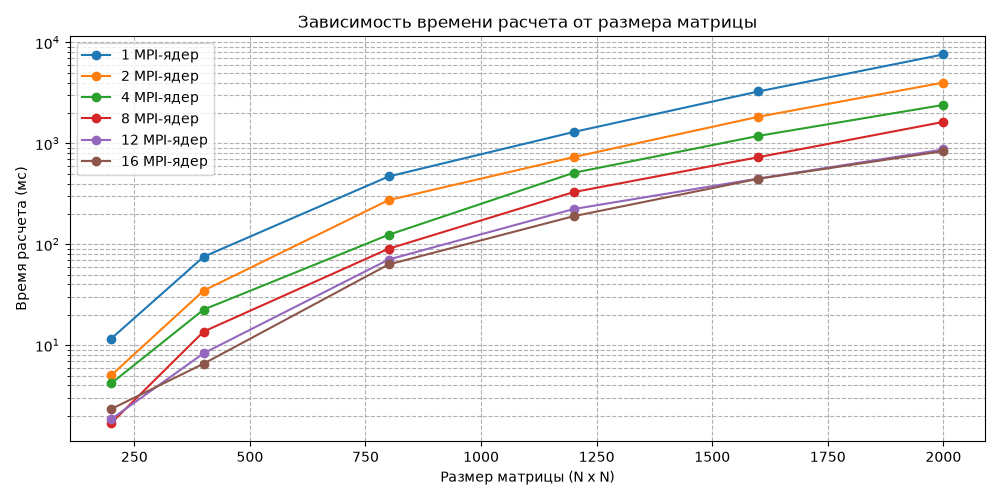
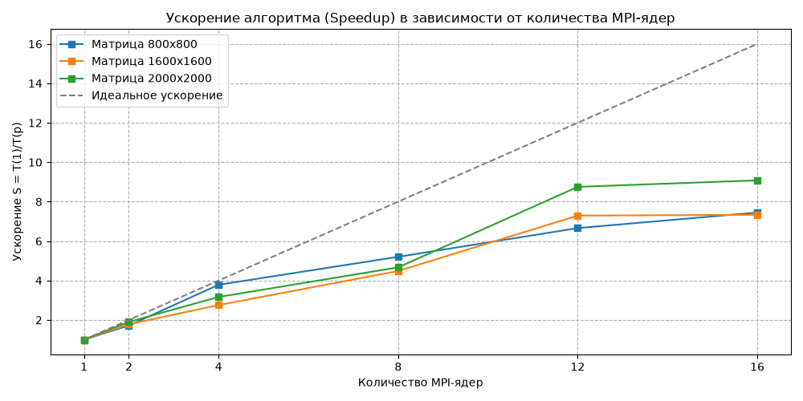

# Лабораторная работа 3

## Использование технологий MPI
Распараллеливание программы с помощью технологий MPI. Были использованы следующие директивы: MPI_Init, MPI_Bcast, MPI_Barrier, MPI_Scatterv, MPI_Gatherv, MPI_Finalize, MPI_Comm_rank.

## СК "Королёв"

Было проведено подключение к суперкластеру Сергей Королёв через сеть sk.ssau.ru через PuTTY и WinCP. 

Инструкция по сборке для одного запуска: mpic++ -O3 -std=c++11 matrix_mpi.cpp -o ./mpi_matrix_exec. Был использован сценарий для запуска matrix_mpi.cpp с разным количеством ядер и размером матрий.

# Сводная таблица производительности MPI

| Размер матрицы (N x N) | MPI-ядра | Время (мс) | Производительность (GFLOPS) | Память под 3 матрицы (МБ) |
| :---    | :--- | :--- | :--- | :--- |
| **200** | 1 | 11.6182 | 1.38 | 0.92 |
| **400** | 1 | 75.2984 | 1.70 | 3.66 |
| **800** | 1 | 469.9955 | 2.18 | 14.65 |
| **1200** | 1 | 1296.2159 | 2.67 | 32.96 |
| **1600** | 1 | 3271.1269 | 2.50 | 58.59 |
| **2000** | 1 | 7613.8490 | 2.10 | 91.55 |
| **200** | 2 | 5.0282 | 3.18 | 0.92 |
| **400** | 2 | 34.7655 | 3.68 | 3.66 |
| **800** | 2 | 273.9186 | 3.74 | 14.65 |
| **1200** | 2 | 731.3626 | 4.73 | 32.96 |
| **1600** | 2 | 1835.4973 | 4.46 | 58.59 |
| **2000** | 2 | 4006.6697 | 3.99 | 91.55   |
| **200** | 4 | 4.1845 | 3.82 | 0.92 |
| **400** | 4 | 22.5395 | 5.68 | 3.66 |
| **800** | 4 | 124.1942 | 8.25 | 14.65 |
| **1200** | 4 | 510.5616 | 6.77 | 32.96 |
| **1600** | 4 | 1186.9849 | 6.90 | 58.59 |
| **2000** | 4 | 2405.3555 | 6.65 | 91.55 |
| **200** | 8 | 1.6911 | 9.46 | 0.92 |
| **400** | 8 | 13.6484 | 9.38 | 3.66 |
| **800** | 8 | 90.3494 | 11.33 | 14.65 |
| **1200** | 8 | 328.8759 | 10.51 | 32.96 |
| **1600** | 8 | 729.8117 | 11.22 | 58.59 |
| **2000** | 8 | 1631.5479 | 9.81 | 91.55 |
| **200** | 12 | 1.8513 | 8.64 | 0.92 |
| **400** | 12 | 8.3192 | 15.39 | 3.66 |
| **800** | 12 | 70.5847 | 14.51 | 14.65 |
| **1200** | 12 | 223.4084 | 15.47 | 32.96 |
| **1600** | 12 | 448.5267 | 18.26 | 58.59 |
| **2000** | 12 | 870.0038 | 18.39 | 91.55 |
| **200** | 16 | 2.3302 | 6.87 | 0.92 |
| **400** | 16 | 6.5603 | 19.51 | 3.66 |
| **800** | 16 | 63.0992 | 16.23 | 14.65 |
| **1200** | 16 | 189.7484 | 18.21 | 32.96 |
| **1600** | 16 | 446.0226 | 18.37 | 58.59 |
| **2000** | 16 | 838.6309 | 19.08 | 91.55 |

# На основе проведенного анализа можно сделать следующие выводы:

• Эффективность распараллеливания: Использование MPI позволяет значительно сократить время вычислений (например, для матрицы 2000x2000 время расчета снизилось с 7613.8 мс на 1 ядре до 838.6 мс на 16 ядрах).

• Предел масштабируемости: Максимальная производительность системы достигается на 12–16 ядрах при больших объемах данных. При этом на малых матрицах (200x200) увеличение числа ядер свыше 8 приводит к падению эффективности из-за возрастания накладных расходов на межпроцессорное взаимодействие.

• Потребление ресурсов: Затраты оперативной памяти зависят исключительно от размера обрабатываемых матриц и не изменяются при масштабировании количества вычислительных ядер, составляя 91.55 МБ для максимального размера 2000x2000.

