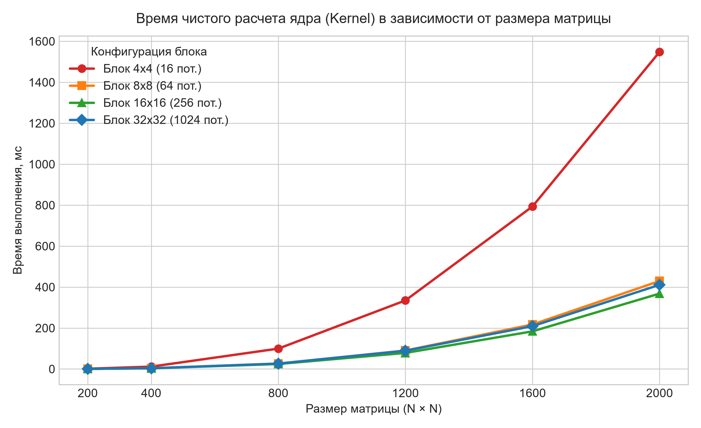
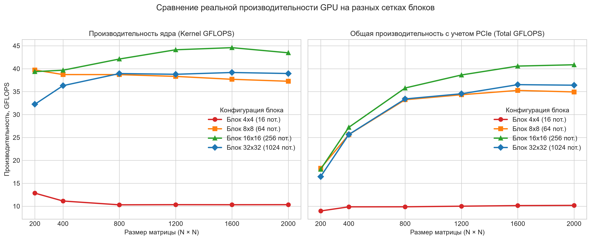
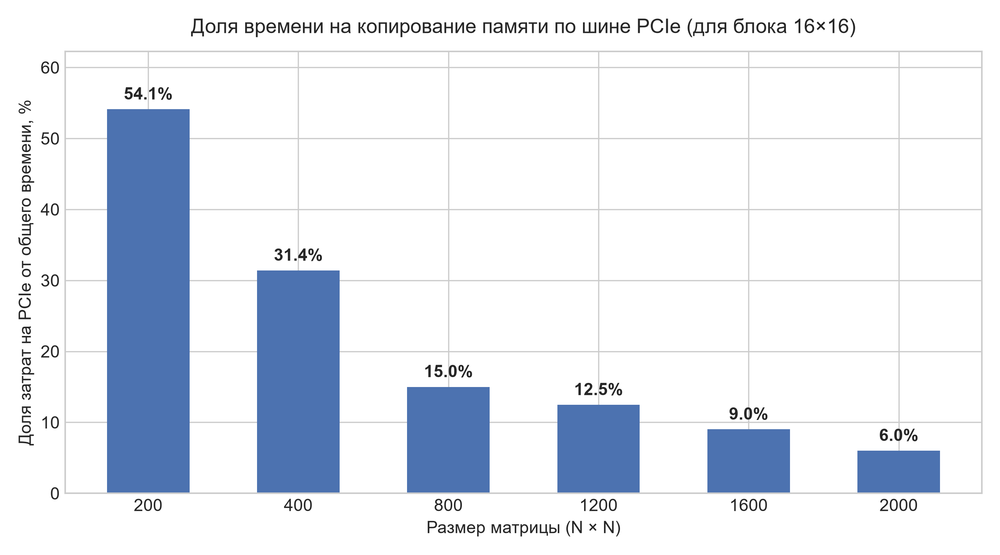

# Лабораторная работа 4

## Использование технологий CUDA
Распараллеливание программы с помощью технологий CUDA.
## Работа на СК "Королёв"

Было проведено подключение к суперкластеру Сергей Королёв через сеть sk.ssau.ru через PuTTY и WinCP. 

### 1. Компиляция вручную
```bash
module load cuda
nvcc -O3 -std=c++11 matrix_cuda.cu -o ./cuda_matrix_exec
```

### 2. Одиночный запуск
```bash
# Синтаксис: ./cuda_matrix_exec <размер_матрицы_N> [размер_стороны_блока]
./cuda_matrix_exec 2000 16
```

# Параллельное умножение матриц на C++ (MPI vs CUDA)

Реализация и сравнительный анализ производительности алгоритма плотного умножения квадратных матриц с использованием двух технологий параллельных вычислений:
1. **MPI (`matrix_mpi.cpp`)** — распределённые вычисления на многоядерном CPU с построчным разбиением матрицы $A$ (`MPI_Scatterv`) и широковещательной рассылкой матрицы $B$ (`MPI_Bcast`).
2. **NVIDIA CUDA (`matrix_cuda.cu`)** — массивно-параллельные вычисления на GPU, где каждый поток сетки `Grid × Block` вычисляет один элемент результирующей матрицы $C$.

---

## Результаты экспериментов (CUDA)

В таблице приведены результаты замеров для матриц размером от $200 \times 200$ до $2000 \times 2000$ при различных конфигурациях двумерного блока потоков.

| Размер матрицы ($N \times N$) | Конфигурация блока (`Block`) | Сетка блоков (`Grid`) | Всего блоков | Время ядра (`Kernel`), мс | Общее время (с PCIe), мс | Производительность (`Kernel`), GFLOPS | Производительность (Общая), GFLOPS | Затраты VRAM, МБ |
| :---: | :---: | :---: | :---: | :---: | :---: | :---: | :---: | :---: |
| **200 × 200** | 4 × 4 (16 пот.) | 50 × 50 | 2 500 | 1.2450 | 1.7866 | 12.85 | 8.96 | 0.92 |
| **200 × 200** | 8 × 8 (64 пот.) | 25 × 25 | 625 | 0.4028 | 0.8759 | 39.72 | 18.27 | 0.92 |
| **200 × 200** | 16 × 16 (256 пот.) | 13 × 13 | 169 | 0.4065 | 0.8860 | 39.36 | 18.06 | 0.92 |
| **200 × 200** | 32 × 32 (1024 пот.) | 7 × 7 | 49 | 0.4962 | 0.9721 | 32.24 | 16.46 | 0.92 |
| **400 × 400** | 4 × 4 (16 пот.) | 100 × 100 | 10 000 | 11.5002 | 12.9785 | 11.13 | 9.86 | 3.66 |
| **400 × 400** | 8 × 8 (64 пот.) | 50 × 50 | 2 500 | 3.3057 | 4.9981 | 38.72 | 25.61 | 3.66 |
| **400 × 400** | 16 × 16 (256 пот.) | 25 × 25 | 625 | 3.2264 | 4.7033 | 39.67 | 27.21 | 3.66 |
| **400 × 400** | 32 × 32 (1024 пот.) | 13 × 13 | 169 | 3.5262 | 4.9923 | 36.30 | 25.64 | 3.66 |
| **800 × 800** | 4 × 4 (16 пот.) | 200 × 200 | 40 000 | 99.3976 | 103.7046 | 10.30 | 9.87 | 14.65 |
| **800 × 800** | 8 × 8 (64 пот.) | 100 × 100 | 10 000 | 26.4527 | 30.8126 | 38.71 | 33.23 | 14.65 |
| **800 × 800** | 16 × 16 (256 пот.) | 50 × 50 | 2 500 | 24.3188 | 28.6099 | 42.11 | 35.79 | 14.65 |
| **800 × 800** | 32 × 32 (1024 пот.) | 25 × 25 | 625 | 26.2987 | 30.6628 | 38.94 | 33.40 | 14.65 |
| **1200 × 1200** | 4 × 4 (16 пот.) | 300 × 300 | 90 000 | 334.6310 | 345.5712 | 10.33 | 10.00 | 32.96 |
| **1200 × 1200** | 8 × 8 (64 пот.) | 150 × 150 | 22 500 | 90.1794 | 100.7080 | 38.32 | 34.32 | 32.96 |
| **1200 × 1200** | 16 × 16 (256 пот.) | 75 × 75 | 5 625 | 78.3125 | 89.4632 | 44.13 | 38.63 | 32.96 |
| **1200 × 1200** | 32 × 32 (1024 пот.) | 38 × 38 | 1 444 | 89.1238 | 100.0943 | 38.78 | 34.53 | 32.96 |
| **1600 × 1600** | 4 × 4 (16 пот.) | 400 × 400 | 160 000 | 793.4465 | 808.7323 | 10.32 | 10.13 | 58.59 |
| **1600 × 1600** | 8 × 8 (64 пот.) | 200 × 200 | 40 000 | 217.3409 | 232.3532 | 37.69 | 35.26 | 58.59 |
| **1600 × 1600** | 16 × 16 (256 пот.) | 100 × 100 | 10 000 | 183.7124 | 201.9135 | **44.59** | 40.57 | 58.59 |
| **1600 × 1600** | 32 × 32 (1024 пот.) | 50 × 50 | 2 500 | 209.1160 | 224.3338 | 39.17 | 36.52 | 58.59 |
| **2000 × 2000** | 4 × 4 (16 пот.) | 500 × 500 | 250 000 | 1548.1874 | 1571.3492 | 10.33 | 10.18 | 91.55 |
| **2000 × 2000** | 8 × 8 (64 пот.) | 250 × 250 | 62 500 | 429.4066 | 458.1122 | 37.26 | 34.93 | 91.55 |
| **2000 × 2000** | 16 × 16 (256 пот.) | 125 × 125 | 15 625 | **368.0688** | **391.6045** | 43.47 | **40.86** | 91.55 |
| **2000 × 2000** | 32 × 32 (1024 пот.) | 63 × 63 | 3 969 | 410.8195 | 439.5842 | 38.95 | 36.40 | 91.55 |

---

## Сравнение производительности: MPI (CPU) против CUDA (GPU)

Ниже приведено прямое сопоставление последовательной версии (`MPI 1 ядро`), максимально распараллеленной версии на CPU (`MPI 16 ядер`) и оптимальной конфигурации GPU (`CUDA блок 16×16`).

| Размер матрицы ($N \times N$) | MPI (1 ядро), мс | MPI (16 ядер), мс | CUDA `16×16` (Kernel), мс | CUDA `16×16` (Общее с PCIe), мс | Ускорение CUDA vs MPI (1 ядро) | Ускорение CUDA vs MPI (16 ядер) |
| :---: | :---: | :---: | :---: | :---: | :---: | :---: |
| **200 × 200** | 11.6182 | 2.3302 | 0.4065 | 0.8860 | **13.11×** | **2.63×** |
| **400 × 400** | 75.2984 | 6.5603 | 3.2264 | 4.7033 | **16.01×** | **1.39×** |
| **800 × 800** | 469.9955 | 63.0992 | 24.3188 | 28.6099 | **16.43×** | **2.21×** |
| **1200 × 1200** | 1296.2159 | 189.7484 | 78.3125 | 89.4632 | **14.49×** | **2.12×** |
| **1600 × 1600** | 3271.1269 | 446.0226 | 183.7124 | 201.9135 | **16.20×** | **2.21×** |
| **2000 × 2000** | 7613.8490 | 838.6309 | 368.0688 | 391.6045 | **19.44×** | **2.14×** |

> *Примечание: коэффициенты ускорения рассчитаны по полному времени работы CUDA.*

---

## Визуализация результатов

Для генерации графиков запустите `python plot_cuda_results.py`.

### 1. Время чистого расчёта ядра (Kernel)


### 2. Реальная производительность (Kernel GFLOPS vs Общая GFLOPS)


### 3. Накладные расходы на передачу данных по шине PCIe


---

## Основные выводы

1. **Выбор оптимальной конфигурации сетки (`16 × 16`).**
   * Блок **`4 × 4` (16 потоков)** показывает критически низкую производительность (~10.3 GFLOPS), так как минимальной единицей планирования в GPU NVIDIA является **варп (warp) из 32 потоков** — ровно половина потоков в каждом варпе простаивает.
   * Блок **`16 × 16` (256 потоков)** является оптимальным для данной задачи, обеспечивая пиковую производительность **44.59 GFLOPS** (на матрице $1600 \times 1600$). Конфигурация `8 × 8` упирается в аппаратный лимит числа активных блоков на мультипроцессор (SM), а `32 × 32` (1024 потока) создаёт повышенную нагрузку на регистровую память.

2. **Влияние накладных расходов шины PCIe.**
   * На малых матрицах ($200 \times 200$) копирование данных между ОЗУ и видеопамятью (`Host ↔ Device`) занимает **54.1%** общего времени выполнения (0.48 мс из 0.89 мс).
   * С ростом размера матрицы вычислительная сложность растёт кубически $O(N^3)$, а объём передаваемых данных — квадратично $O(N^2)$. На матрице $2000 \times 2000$ доля пересылки по PCIe снижается до **6.0%** (23.5 мс из 391.6 мс).

3. **Преимущество CUDA перед MPI.**
   * Даже с учётом пересылки данных по PCIe и использования вычислений двойной точности (`double`), видеокарта опережает **1 ядро CPU в 19.44 раза**, а **16 ядер CPU (MPI) — в 2.14–2.63 раза** (на матрице $2000 \times 2000$: **391.6 мс** против **838.6 мс**).

