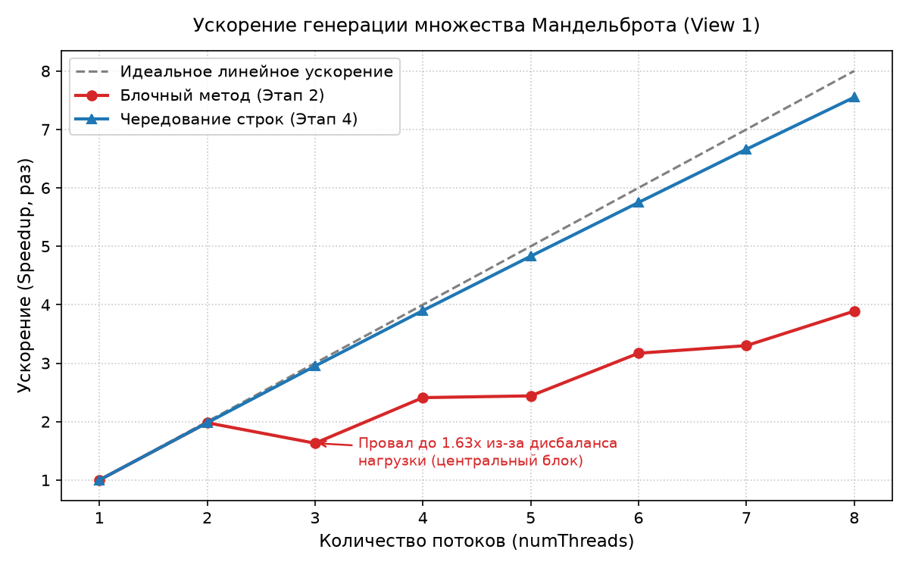
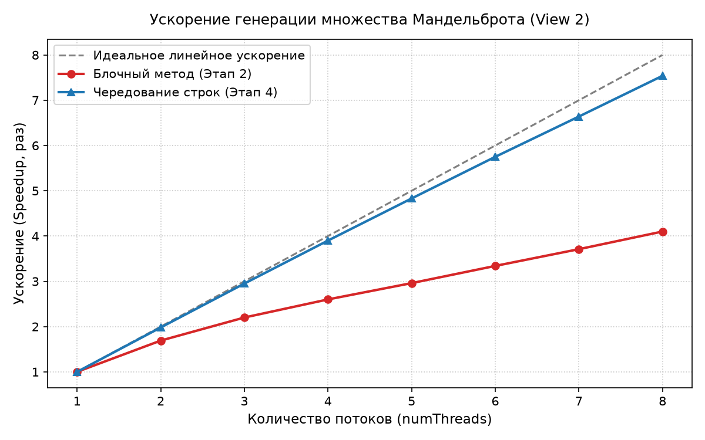

# Лабораторная работа 5

## Параллельное вычисление множества Мандельброта (`std::thread`)

## Блочное разделение работы (Spatial Block Decomposition)

На первом и втором этапах изображение размером $1600 \times 1200$ пикселей было разделено на $N$ горизонтальных полос (`numThreads`), каждая из которых обрабатывалась отдельным потоком. Для корректной обработки случаев, когда высота изображения не делится на количество потоков нацело (например, $N = 7$), остаток от деления равномерно распределялся по одной строке между первыми потоками.

### Реализация `workerThreadStart` (блочный метод)
```cpp
void workerThreadStart(WorkerArgs * const args) {
    int rowsPerThread = args->height / args->numThreads;
    int remainder = args->height % args->numThreads;

    int startRow = args->threadId * rowsPerThread + std::min(args->threadId, remainder);
    int numRows = rowsPerThread + (args->threadId < remainder ? 1 : 0);

    mandelbrotSerial(
        args->x0, args->y0, args->x1, args->y1,
        args->width, args->height,
        startRow, numRows,
        args->maxIterations,
        args->output
    );
}
```

---

## Анализ ускорения и гипотеза

В ходе тестирования были получены следующие значения ускорения (Speedup) относительно последовательной реализации:

| Количество потоков | Блочный метод (View 1) | Блочный метод (View 2) | Чередование строк (View 1) | Чередование строк (View 2) |
| :---: | :---: | :---: | :---: | :---: |
| **1** | 1.00x | 1.00x | 1.00x | 1.00x |
| **2** | 1.98x | 1.69x | 1.98x | 1.98x |
| **3** | **1.63x** | 2.20x | 2.95x | 2.95x |
| **4** | 2.41x | 2.60x | 3.90x | 3.90x |
| **5** | 2.44x | 2.96x | 4.83x | 4.83x |
| **6** | 3.17x | 3.34x | 5.75x | 5.75x |
| **7** | 3.30x | 3.71x | 6.66x | 6.64x |
| **8** | **3.89x** | **4.10x** | **7.55x** | **7.54x** |




### Является ли ускорение линейным?
**Нет**, при блочном разделении ускорение нелинейно. На графике для **View 1** наблюдается резкий провал при переходе от 2 потоков (`1.98x`) к 3 потокам (`1.63x`), а на 8 потоках ускорение достигает лишь **3.89x** вместо ожидаемых ~7–8x.

### Гипотеза
Причиной сублинейного ускорения является **дисбаланс вычислительной нагрузки (Load Imbalance)**:
* Вычислительная сложность пикселя зависит от того, принадлежит ли точка множеству Мандельброта. Темные области (внутри множества) требуют выполнения всех `maxIterations = 256` итераций, в то время как светлые области (снаружи множества) отсеиваются за несколько итераций.
* Изображение **View 1** симметрично относительно горизонтальной оси, а основная масса «тяжелых» черных пикселей сосредоточена в центральной полосе.
* При запуске на **2 потоках** изображение делится ровно пополам по оси симметрии, поэтому оба потока получают одинаковую долю сложных пикселей (`1.98x`).
* При запуске на **3 потоках** средний поток (`threadId = 1`) получает центральную треть изображения со всей самой «тяжелой» областью, в то время как крайние потоки (`threadId = 0` и `threadId = 2`) получают преимущественно «легкие» светлые области. Общее время выполнения определяется самым медленным потоком, пока остальные простаивают в ожидании синхронизации (`join`).

---

## Экспериментальное подтверждение гипотезы

Для проверки гипотезы в начало и конец функции `workerThreadStart()` были добавлены замеры времени с помощью `CycleTimer::currentSeconds()`.

### Результаты замеров для 3 потоков (Блочный метод, View 1)
При времени последовательной версии `~180.0 мс`:
* **`Thread 0`** (строки `0–399`): **35.5 мс**
* **`Thread 1`** (строки `400–799`): **108.8 мс**
* **`Thread 2`** (строки `800–1199`): **35.7 мс**

**Вывод:** Замеры полностью подтвердили гипотезу. Центральный поток (`Thread 1`) выполняет более 60% всей вычислительной работы и работает в **3 раза дольше** крайних потоков. Около 70% времени два ядра процессора простаивают, что объясняет падение ускорения до $180.0 / 108.8 \approx 1.65\text{x}$ (с учетом накладных расходов — `1.63x`).

---

## Оптимизация балансировки нагрузки: чередование строк

Для устранения дисбаланса нагрузки без использования примитивов синхронизации (мьютексов, атомарных счетчиков) была применена **статическая политика циклического чередования строк (Interleaved / Strided Decomposition)**.

### Подход к распараллеливанию
Вместо выделения каждому потоку одного непрерывного блока строк, поток с номером `threadId` вычисляет каждую `numThreads`-ю строку изображения (`threadId`, `threadId + numThreads`, `threadId + 2 * numThreads` и т. д.).

### Итоговая реализация `workerThreadStart`
```cpp
void workerThreadStart(WorkerArgs * const args) {
    for (unsigned int j = args->threadId; j < args->height; j += args->numThreads) {
        mandelbrotSerial(
            args->x0, args->y0, args->x1, args->y1,
            args->width, args->height,
            j, 1,
            args->maxIterations,
            args->output
        );
    }
}
```

### Преимущества подхода и итоговый результат
1. **Равномерная нагрузка:** Соседние строки изображения имеют практически идентичную вычислительную сложность. Циклическое распределение гарантирует, что каждый поток получит равную долю как сложных центральных, так и простых периферийных строк на любом виде (как View 1, так и View 2).
2. **Отсутствие синхронизации и гонок данных:** Потоки записывают результаты в строго непересекающиеся области массива `output`, поэтому блокировки не требуются.
3. **Отсутствие False Sharing:** Длина одной строки составляет $1600 \times 4\text{ байта} = 6400\text{ байт}$, что кратно размеру кэш-линии процессора (64 байта), исключая конфликты кэша между ядрами.
4. **Итоговое ускорение на 8 потоках:** На обоих представлениях множества Мандельброта достигнуто почти линейное ускорение:
   * **View 1:** **7.55x**
   * **View 2:** **7.54x**
